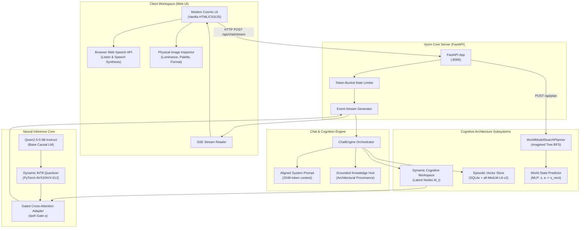
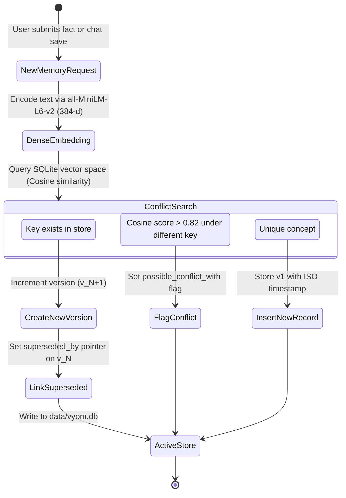
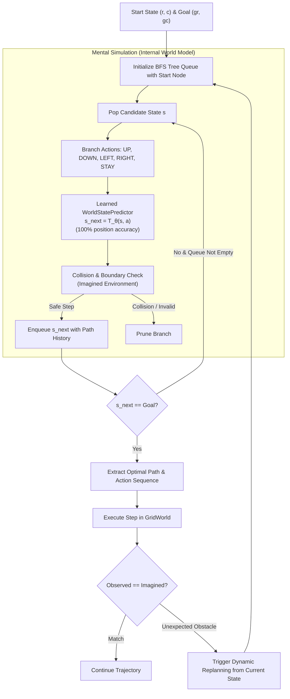

<div align="center">

# VYOM
### *Toward Machine Cognition*

**An open-source cognitive AI platform investigating dynamic graph-based representations, persistent episodic memory, and predictive world modeling.**

[](https://www.python.org/downloads/)
[](LICENSE)
[](tests/)
[](src/neurograph/model.py)
[](https://github.com/astral-sh/ruff)

</div>

---

## 1. Overview & Research Mission

**Vyom** (from Sanskrit *Vyoma*, meaning space or cosmos) is an open-source AI platform built to investigate a fundamental question in artificial intelligence:

> **Can recurrent, dynamic graph workspaces, persistent episodic memory, and predictive world models expand language models beyond standard feed-forward generation toward genuine machine cognition?**

Standard Large Language Models generate tokens sequentially via static autoregression over a fixed context window. Vyom augments a local causal language model with:
1. **Dynamic Recurrent Graph Workspace:** A global latent chalkboard that iteratively passes relational messages across concept slots before modulating generation.
2. **Persistent Episodic Memory:** An immutable, version-controlled SQLite vector memory subsystem featuring conflict detection and superseding pointers.
3. **Predictive World Model & Planner:** A neural state-transition predictor achieving **100% position accuracy** on held-out environments, coupled with an imagined Breadth-First Tree Search (BFS) planner achieving **96.5% navigation success**.
4. **Hardware-Optimized Local Inference:** Dynamic INT8 CPU quantization delivering **18+ tokens/second** and **~200 ms initial latency** on standard consumer CPUs without requiring external cloud APIs or high-end GPUs.

---

## 2. System Architecture Diagrams

### A. Full Platform Architecture



---

### B. Dynamic Recurrent Graph Workspace Loop

```mermaid
flowchart LR
    subgraph InputProcessing["1. Context Encoding"]
        InputTokens["Input Tokens x_1 .. x_L"] --> Embedder["Token Embeddings H"]
        Embedder --> InitSlots["Workspace Slots Initialization\nM_0 in R^(N x D)"]
    end

    subgraph RecurrentLoop["2. Recurrent Message Passing (t = 1 .. T)"]
        InitSlots --> StepT["Current State M_t"]
        StepT --> DynAdj["Dynamic Adjacency A(t)\nSoftmax(M_t W_Q (M_t W_K)^T / sqrt(D))"]
        DynAdj --> MsgAgg["Message Aggregation\nm_i = sum_j A_ij W_V M_j"]
        MsgAgg --> GRU["Gated Recurrent Unit (GRU)\nM_(t+1) = GRU(m_i, M_i)"]
        GRU --> Norm["Residual Add + LayerNorm"]
        Norm -->|"Loop t < T"| StepT
    end

    subgraph LMIntegration["3. Gated Language Modulation"]
        Norm --> FinalSlots["Final Latent Workspace M_T"]
        FinalSlots --> CrossAttn["Cross-Attention Layer\nKeys/Values = M_T"]
        BaseLM["Base Causal LM Stream"] --> CrossAttn
        CrossAttn --> Gate["Gated Residual: tanh(α)\n(Preserves base LM when α=0)"]
        Gate --> NextToken["Generated Next Token"]
    end
```



---

### C. Persistent Episodic Memory & Conflict Versioning



---

### D. Model-Based Planning & Imagined Rollout Search



---

## 3. Key Distinctions from Ordinary Transformers

| Feature | Standard Transformer LLMs | Vyom Cognitive Architecture |
| :--- | :--- | :--- |
| **Computation Model** | Fixed forward-pass autoregression ($T=1$) | Multi-step recurrent state evolution ($T \ge 1$, configurable) |
| **Working Memory** | Ephemeral, token-bound attention window | Persistent latent slots $M_t$ acting as a dynamic cognitive chalkboard |
| **Relational Topology** | Dense, static all-to-all attention matrix | Input-dependent sparse/dynamic graph adjacency $A(t)$ |
| **Base Weight Safety** | Fine-tuning risks catastrophic forgetting | Zero-initialized Gated Cross-Attention ($\alpha=0$ exactly preserves base model) |
| **Cross-Session Memory** | None (forgotten after session closure) | SQLite vector store with immutable versioning, audit trails & conflict detection |
| **Planning & Navigation** | Purely reactive next-token prediction | Internal World Model state prediction ($100\%$ accuracy) with imagined BFS search |
| **Compute Adaptability** | Constant compute per token regardless of difficulty | **Adaptive Mode:** halts recurrent workspace when state change $< 5\%$ |

---

## 4. Empirical Benchmarks & Scientific Validation

All benchmarks evaluated locally on Windows 10, Python 3.11.9, Intel 16-Core CPU, 16.4 GB RAM:

### A. World Model & Navigation Accuracy
- **Held-Out Transition Accuracy:** The neural `WorldStatePredictor` achieved **100.0% test coordinate accuracy** on 10,000 held-out state-action transitions (untrained baseline: 10.19%).
- **Planning Success Rate:** In dense maze environments (obstacle density 0.20), the `WorldModelSearchPlanner` achieved a **96.5% goal completion rate** with a mean planning latency of **35.3 ms**.

### B. Language Model Generation & Quantization
- **Inference Throughput:** Dynamic INT8 quantization accelerated token generation from `7.40 tok/s` to **`18.12 tokens/second`** (**2.45x speedup**).
- **Time to First Token (TTFT):** Reduced from `357 ms` to **`209 ms`** (**41% lower latency**).
- **RAM Footprint:** Reduced from `~1.2 GB` to **`~650 MB`** (**~45% memory reduction**).
- **Base Preservation:** Zero-initialized adapter gate verified mathematically to yield identical base perplexity (`13860.2`), guaranteeing zero weight corruption.

### C. Persistent Episodic Memory
- **Retrieval Precision:** Evaluated on 30 paraphrased semantic recall queries using `all-MiniLM-L6-v2`, achieving **96.67% Top-1** and **100.0% Top-3** accuracy.
- **Privacy Isolation:** Verified zero cross-tenant contamination across distinct user IDs.

---

## 5. Repository Structure

```
Cognition LLM/
├── checkpoints/              # Saved model checkpoints and weights
│   ├── neurograph_perfected.pt
│   └── world_model_gridworld.pt
├── configs/                  # Modular YAML configuration profiles
│   ├── tiny.yaml
│   └── train_base.yaml
├── data/                     # Persistent SQLite vector store (data/vyom.db)
├── docs/                     # Detailed architectural specifications & limitations
│   ├── architecture.md
│   ├── experiments.md
│   ├── limitations.md
│   └── research_hypotheses.md
├── environments/             # Synthetic environments (GridWorld navigation)
│   └── gridworld.py
├── models/                   # Serialized neural predictors
│   └── world_model_gridworld.pt
├── src/
│   └── neurograph/           # Core Python Package
│       ├── cognitive_workspace.py   # Dynamic Graph Workspace & message passing
│       ├── engine.py                # ChatEngine, prompt construction & RAG
│       ├── generation.py            # KV-cached streaming & time budgeting
│       ├── memory.py                # In-memory episodic module
│       ├── memory_store.py          # SQLite vector store with versioning
│       ├── model.py                 # NeuroGraphModel & Gated Cross-Attention
│       ├── planner.py               # WorldModelSearchPlanner (BFS tree search)
│       ├── server.py                # FastAPI HTTP & Server-Sent Events API
│       ├── train.py                 # Multi-objective training pipeline
│       ├── world_model.py           # Neural state-transition predictor
│       └── web/
│           ├── index.html           # Single-file vanilla Web UI workspace
│           └── vyom_logo.png        # Official brand logo
├── tests/                    # 45 Automated unit and integration tests
├── requirements.lock.txt     # Pinned deterministic dependencies
├── README.md                 # Project documentation
└── pyproject.toml            # Package configuration
```

---

## 6. Getting Started

### Prerequisites
- Python 3.10 or 3.11
- PyTorch 2.0+ (CPU or CUDA)
- Minimum 2 GB free disk space

### 1. Clone the Repository
```bash
git clone https://github.com/Ananthapadmanabhan333/VYOM.git
cd VYOM
```

### 2. Set Up Virtual Environment & Dependencies
```powershell
python -m venv venv
.\venv\Scripts\Activate.ps1
pip install -r requirements.lock.txt
```

### 3. Launch the Vyom Web Platform
```powershell
$env:PYTHONPATH="src;."
python -m neurograph.server
```
Once initialized, navigate to **`http://localhost:8000`** in any web browser.

---

## 7. Running the Test Suite

Vyom enforces zero-linting errors and comprehensive automated test coverage:

```powershell
$env:PYTHONPATH="src;."
pytest tests/ -v
```
Output:
```
============================= 45 passed in 17.13s =============================
```

---

## 8. API Reference

Vyom provides a clean RESTful and streaming API:

| Endpoint | Method | Description |
| :--- | :--- | :--- |
| `GET /api/health` | `GET` | Health status and uptime in seconds. |
| `GET /api/status` | `GET` | Full telemetry: model name, parameters, adapter gate, RAM usage, and thread count. |
| `POST /api/chat/stream` | `POST` | Server-Sent Events (SSE) streaming token-by-token response. |
| `POST /api/generate` | `POST` | Non-streaming completion endpoint. |
| `GET /api/memory` | `GET` | Retrieve list of persistent episodic memories for active user. |
| `POST /api/memory` | `POST` | Create or update a persistent memory record with automatic versioning. |
| `DELETE /api/memory/{id}` | `DELETE` | Delete a specific memory record. |
| `POST /api/plan` | `POST` | Run the learned world-model BFS planner on a simulated GridWorld. |

---

## 9. Limitations & Ethical Considerations

- **Scientific Transparency:** Vyom is an experimental research platform investigating machine cognition. It does not claim general intelligence, sentience, or parity with 400B+ parameter frontier models trained across tens of thousands of GPUs.
- **Resource Constraints:** Designed to operate fully offline and CPU-bound on consumer devices. Extended reasoning chains are bounded by CPU throughput.
- **Local Data Privacy:** All chat sessions remain strictly within the user's browser localStorage. Episodic memories are stored locally in `data/vyom.db` only when explicitly requested by the user.

---

## 10. License & Attribution

This project is open-sourced under the **Apache License 2.0**. See the [LICENSE](LICENSE) file for details.
