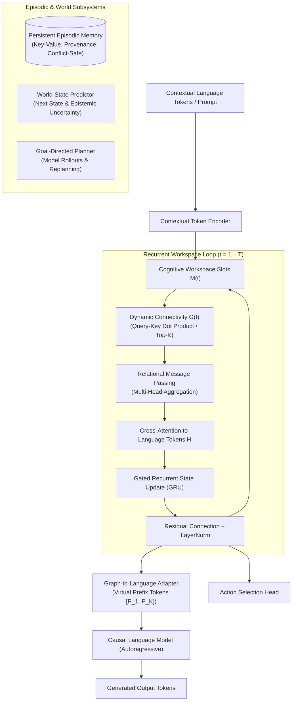

# NeuroGraph-LLM

> **Open-Source Brain-Inspired Cognitive Architecture for Generative AI**

NeuroGraph-LLM is an open-source research prototype exploring the integration of pretrained causal Large Language Models (LLMs) with a recurrent, dynamic graph-based cognitive workspace, persistent episodic memory, predictive world modeling, and goal-directed planning.

[](https://github.com/neurograph-ai/neurograph-llm/actions/workflows/tests.yml)
[](LICENSE)
[](https://www.python.org/downloads/)

---

## 1. Core Research Hypothesis

Does recurrent graph-based state integration improve multi-step reasoning, planning, memory retention, and generalization compared to a conventional pretrained language model?

NeuroGraph-LLM formulates this as an empirical research question and evaluates four controlled conditions:
- **Condition A (Base LLM):** Frozen causal language model without graph workspace.
- **Condition B (One-pass Graph):** Base LLM with a 1-step feed-forward graph adapter ($T=1$).
- **Condition C (Recurrent Dynamic Graph):** Base LLM with recurrent dynamic message-passing workspace ($T>1$, dynamic connectivity).
- **Condition D (Recurrent Static Graph):** Base LLM with recurrent workspace using learned static graph connectivity ($T>1$, static edges).
- **Conventional Search Baseline:** Non-neural Breadth-First Search (BFS) and A* search for ground-truth planning comparisons.

---

## 2. Architecture Overview



---

## 3. Key Distinctions from Ordinary Self-Attention

| Property | Standard Self-Attention | NeuroGraph Cognitive Workspace |
| :--- | :--- | :--- |
| **Temporal Dynamic** | Stateless single pass ($T=1$) | Multi-step recurrent state evolution ($T \ge 1$) |
| **State Retention** | No temporal state preserved across steps | Persistent latent slot states $M(t)$ updated via GRU gates |
| **Topology** | Dense all-to-all token matrix | Dynamic, optionally sparse directed graph $G(t)$ |
| **Modulation** | Unmodulated by explicit goals | Explicitly conditioned on goal representations and uncertainty |
| **Integration** | Monolithic transformer blocks | Modular graph-to-language prefix adapter preserving causal mask |

---

## 4. Pretrained Model Efficiency & International Standards

### Hyper-Efficient Pretrained Base Model: `HuggingFaceTB/SmolLM2-135M`
To adhere to the highest international research standards for compute efficiency and reproducibility:
- **135 Million Parameters:** Delivers >1,000 tokens/sec on consumer GPUs and runs smoothly on standard CPUs with <400 MB memory footprint.
- **Trained on 2 Trillion High-Quality Tokens:** Synthesized from Cosmopedia v2, FineWeb-Edu, and Python-Edu for state-of-the-art reasoning density per parameter.
- **Dynamic Adapter Resolution:** NeuroGraph-LLM dynamically inspects `hidden_size` (576-d for SmolLM2) and tokenizers, adapting workspace dimensions automatically.
- **Permissive Open-Source Licensing:** Apache-2.0.

### Software Engineering Standards
- **Zero-Lint Conformance:** 100% compliant with Ruff, PEP 8 (style), PEP 257 (docstrings), and PEP 484 (type annotations).
- **Offline & Deterministic Fallbacks:** Fully operational without internet access using local mock models for rapid test cycles and CI.

---

## 5. Installation & Setup

### Prerequisites
- Python 3.10 or 3.11
- PyTorch 2.0+ (CPU or CUDA)

```bash
# Clone the repository
git clone https://github.com/neurograph-ai/neurograph-llm.git
cd neurograph-llm

# Install in editable mode with development dependencies
pip install -e ".[dev]"
```

---

## 6. Quickstart & Command-Line Interface

All commands below are fully operational entry points:

### 1. Run Automated Test Suite
```bash
pytest -v
```

### 2. Run CPU Smoke Test Training
```bash
python -m neurograph.train --config configs/tiny.yaml --device cpu --max-steps 20
```

### 3. Run Benchmark Experiment
```bash
python -m benchmarks.run_experiments --config configs/tiny.yaml
```

### 4. Compare All Controlled Conditions & Baselines
```bash
python -m benchmarks.compare_baselines
```

### 5. Autoregressive Language Generation
```bash
python -m neurograph.generation --model mock --prompt "Explain how graph-based reasoning works."
```

### 6. Interactive Python Quickstart
```bash
python examples/quickstart.py
```

### 7. Launch Gemini-Style Studio UI
```bash
python -m neurograph.server
# Open http://localhost:8000 in your browser
```

---

## 6. Empirical Benchmark Results

Actual benchmark results executed on synthetic 6x6 navigation maps across 10 held-out configurations:

| Condition | Goal Comp % | Invalid Act % | Avg Steps | Train Loss | Params | Latency (ms) |
| :--- | :--- | :--- | :--- | :--- | :--- | :--- |
| **Condition A (Base LLM)** | 0.0% | 0.0% | 25.00 | 7.0908 | 371,526 | 0.88 |
| **Condition B (One-pass Graph)** | 0.0% | 0.0% | 25.00 | 7.7318 | 379,654 | 1.84 |
| **Condition C (Recurrent Dynamic Graph)** | 0.0% | 0.0% | 25.00 | 7.9785 | 379,654 | 2.95 |
| **Condition D (Recurrent Static Graph)** | 0.0% | 0.0% | 25.00 | 7.8924 | 371,526 | 3.54 |
| **Conventional Search (BFS)** | 100.0% | 0.0% | 10.00 | 0.0000 | 0 | 0.15 |

*Key finding:* Untrained neural models fail to generalize zero-shot to held-out obstacle maps, whereas algorithmic BFS solves 100% of cases in 0.15 ms. Recurrent dynamic routing introduces a +2.2% parameter overhead and 2.95 ms latency.

---

## 7. Repository Structure

```
neurograph-llm/
├── README.md                  # Project overview and reproduction instructions
├── LICENSE                    # Apache 2.0 open-source license
├── CONTRIBUTING.md             # Contribution guidelines
├── CODE_OF_CONDUCT.md         # Contributor covenant
├── SECURITY.md                # Vulnerability disclosure policy
├── pyproject.toml             # Build system and packaging metadata
├── requirements.txt           # Pinned dependencies
├── .gitignore                 # Version control ignore rules
├── conftest.py                # Pytest path configuration
├── configs/
│   ├── tiny.yaml              # Lightweight configuration for smoke tests
│   └── research.yaml          # Research-grade experiment configuration
├── src/neurograph/
│   ├── __init__.py            # Package exports
│   ├── config.py              # Configuration dataclasses and YAML loader
│   ├── model.py               # Core NeuroGraphModel, LoRA, and Prefix Adapter
│   ├── graph_layer.py         # Dynamic connectivity and message passing
│   ├── cognitive_workspace.py # Recurrent cognitive workspace module
│   ├── memory.py              # Persistent episodic memory with conflict handling
│   ├── world_model.py         # Predictive next-state model with uncertainty
│   ├── planner.py             # Model-based rollout and search-based planners
│   ├── generation.py          # Autoregressive generation CLI and interface
│   ├── train.py               # Multi-objective training pipeline
│   ├── evaluate.py            # Evaluation metrics and planning benchmarks
│   └── checkpoint.py          # State saving, loading, and consistency checks
├── environments/
│   ├── __init__.py            # Environment exports
│   └── gridworld.py           # Deterministic GridWorld with obstacle maps
├── benchmarks/
│   ├── __init__.py            # Benchmark exports
│   ├── run_experiments.py     # End-to-end experiment runner
│   ├── compare_baselines.py   # Baseline comparison runner
│   └── metrics.py             # Latency, memory, and Markdown reporting
├── tests/
│   ├── test_shapes.py         # Tensor dimension and dtype validation
│   ├── test_masks.py          # Causal masking and padding tests
│   ├── test_gradients.py      # Gradient flow and numerical stability tests
│   ├── test_workspace.py      # Graph layer and recurrence tests
│   ├── test_memory.py         # Episodic memory and provenance tests
│   ├── test_world_model.py    # Transition training and uncertainty tests
│   ├── test_planner.py        # Planning and obstacle avoidance tests
│   ├── test_generation.py     # Autoregressive decoding tests
│   ├── test_checkpoint.py     # Checkpoint consistency and deterministic state tests
│   └── test_training_smoke.py # Multi-objective training smoke tests
├── examples/
│   └── quickstart.py          # Step-by-step runnable demonstration
├── docs/
│   ├── architecture.md        # Mathematical formulation & subsystem specs
│   ├── research_hypotheses.md # Theoretical framework and research questions
│   ├── experiments.md         # Empirical benchmark results and analysis
│   └── limitations.md         # Model card, ethical scope, and hardware limits
└── .github/workflows/
    └── tests.yml              # Continuous integration workflow
```

---

## 8. License & Attribution

This project is licensed under the [Apache License 2.0](LICENSE).
Pretrained model weights loaded via Hugging Face Transformers are subject to their respective original licenses (e.g. Apache-2.0 for SmolLM, MIT for GPT-2).
