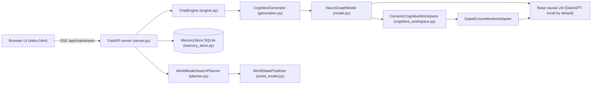

# Vyom Architecture

This document describes what the code in `src/neurograph/` actually does. Where a component
is experimental or has not been shown to help, that is stated explicitly.



Model weights, inference configuration, cognitive state, and user memory are separate:

| Component | Where it lives | Persisted? |
| :--- | :--- | :--- |
| Base LM weights | Hugging Face cache (read-only, offline by default) | yes (HF cache) |
| Workspace / adapter weights | `NeuroGraphModel`; optional checkpoint via `VYOM_CHECKPOINT` | only if you save one |
| Inference config | request parameters + `MODES` in `engine.py` + env vars | no |
| Cognitive state (workspace nodes) | computed per request, discarded after the reply | no |
| User memory | `data/vyom.db` (SQLite), per user | yes, only on explicit save |
| World model | `models/world_model_gridworld.pt` (36k params) | yes |

## 1. Dynamic graph workspace

`DynamicCognitiveWorkspace` holds `N` learned slot vectors `M(0)` (default 8 × 64). For
`t = 1..T`:

1. **Read**: slots cross-attend to the context features `H` (with padding mask).
2. **Input-dependent connectivity**: `G(t) = softmax(q(M) k(M)^T / sqrt(d))`, optionally
   sparsified to top-k edges per node (`top_k_edges`). With `dynamic_connectivity=False`
   (Condition D) a learned static adjacency is used instead.
3. **Message passing**: multi-head aggregation of neighbour messages weighted by `G(t)`.
4. **Gated recurrent update**: GRU-style gate `M(t+1) = (1-z)·M(t) + z·h̃`, followed by a
   residual connection and LayerNorm.
5. **Adaptive halting** (optional, `halt_threshold`): per sample, once
   `||M(t+1)-M(t)|| / ||M(t)||` falls below the threshold (after `min_steps`), that sample's
   state is frozen while others continue. The number of executed steps is returned.

**Context features.** With `context_source="hidden"` (default) `H` is the base LM's final
hidden states over the prompt — contextual and order-aware. The legacy `"embeddings"` option
read raw token embeddings, which carry no positional information.

### How this differs from ordinary Transformer attention

| | Transformer self-attention | Vyom workspace |
| :--- | :--- | :--- |
| What attends | every token to every earlier token | a small, fixed set of `N` latent slots |
| State across iterations | none inside a layer; depth is fixed by layer count | slots are carried across `T` recurrent steps with a GRU gate (weights shared across steps) |
| Graph | implicit, token × token, recomputed per layer | explicit `N × N` adjacency over slots, inspectable per step, optionally sparse or static |
| Compute | fixed per token | `O(T·N²)` extra per prompt, independent of reply length; `T` can adapt per sample |
| Coupling to the LM | is the LM | reads LM hidden states; writes back through a gated adapter |

Mathematically the workspace is a recurrent, weight-tied attention module over latent slots
(related to Perceiver-style latents and Slot Attention). It is not a model of biological
cognition.

## 2. Interface to the language model (why it is "integrated")

`GatedCrossAttentionAdapter` (default, `adapter_mode="gated_cross"`):

```
e_i' = e_i + tanh(g) · W_o · Attn(q = W_q·LN(e_i), K, V = W_k,v · P(M_T))
```

applied to **every** input embedding — prompt tokens and each generated token — before the
LM. Properties (all covered by tests):

* `g` is initialised to 0, so a freshly added workspace is an *exact identity*: Condition C
  produces byte-identical text to Condition A (`tests/test_gradients.py`). The previous
  prefix adapter, untrained, raised DialoGPT perplexity from ~121 to ~2,800 (see
  `docs/BENCHMARKS.md`).
* The gate still receives gradient at init, so training can open it.
* No sequence-length change and no position shift, so it composes with the KV cache: each
  new token is injected independently against the fixed final nodes.

**Honesty note.** The shipped chat model has no trained workspace checkpoint, so the gate is 0
and the workspace does *not* change chat replies. The UI and `/api/status` say so. The
workspace telemetry (adjacency, step deltas, steps executed) is still real computation.

The legacy prefix adapter is kept behind `adapter_mode="prefix"` for ablations.

## 3. Generation

`CognitiveGenerator.stream()`:

* runs the workspace once over the prompt;
* decodes with a KV cache on Hugging Face backends (measured ~2.3× faster than recompute
  at 48–64 tokens, identical tokens);
* supports greedy / temperature / top-k / top-p sampling and repetition penalty;
* stops on tokenizer EOS, `max_new_tokens`, a wall-clock budget (`VYOM_MAX_TIME_S`, default
  2 s), the model's context limit, or a cancellation `threading.Event`;
* records measured timings and the stop reason in `last_stats`.

`ChatEngine` formats history with the tokenizer's chat template (DialoGPT's template joins
turns with EOS), truncates to the last 6 turns / 256 prompt tokens, retrieves memories, and
emits SSE events. Replies are labelled by `source`: `model`, `curated` (a short list of
accurate self-descriptions the small base model cannot produce), or `image_metadata`.

### Modes

| Mode | Computation |
| :--- | :--- |
| Fast | Condition A: base LM only |
| Cognitive | Condition C: workspace, 3 fixed steps |
| Adaptive | Condition C with halting at 5% relative change, max 6 steps |

## 4. Persistent memory (`memory_store.py`)

* Created only by explicit user action; conversations are never stored automatically.
* Per-user isolation on every query; optional bearer-token auth maps tokens to users.
* Provenance (`source`, `conversation_id`), `created_at`, `updated_at`, `version`.
* Conflicts: same `key` ⇒ the old record is superseded (kept, versioned); un-keyed records
  with cosine ≥ 0.85 to an existing one are flagged `possible_conflict_with`.
* Inspect / edit / delete / wipe / disable via API and UI. Disabled ⇒ nothing retrieved.
* Embeddings: all-MiniLM-L6-v2 from the local HF cache if present, else a hashed
  bag-of-words fallback. Retrieved memories (score ≥ 0.35, top 3) are prepended to the
  prompt and listed in the reply's metadata.

`memory.py` (`EpisodicMemory`) is the older vector-level research store used inside
`NeuroGraphModel`; it is not used for user memory.

## 5. World model and planning

* `world_model_training.py` collects real GridWorld transitions (random walks on map seeds
  0–199) and trains `WorldStatePredictor` (residual MLP with a Gaussian NLL head). Evaluation
  is on unseen maps 1000–1099 and includes a "copy current state" baseline.
* `WorldModelSearchPlanner` plans by breadth-first search over transitions *imagined* by the
  world model, decoding predicted positions from the state vector. It executes one action,
  observes the real outcome, remembers blocked moves and observed cells, and replans. It
  never reads the obstacle map; it only sees position, goal and four local wall sensors.
* `/api/plan` reports `planner_used` and shows a BFS oracle separately. The previous server
  silently replaced failed model plans with A*; that fallback was removed.

## 6. Recurrent reasoning state and limits

The workspace state is recomputed per prompt and discarded; nothing leaks between requests or
users. Whether more recurrent steps improve multi-step tasks is measured in
`benchmarks/run_all.py` (`reasoning`, `adaptive`) — see `docs/BENCHMARKS.md` for the actual
results, including negative ones.
