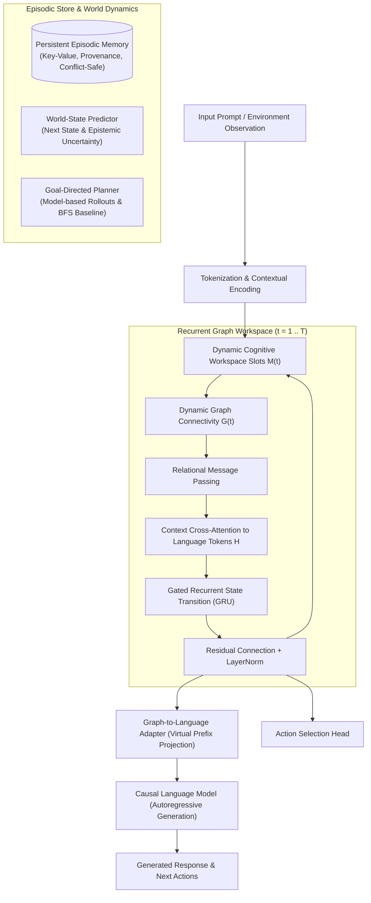

# NeuroGraph-LLM Architecture Specification

## 1. System Overview

NeuroGraph-LLM is an experimental brain-inspired cognitive architecture that integrates a causal pretrained Large Language Model (LLM) with a recurrent, dynamic graph-based cognitive workspace, persistent episodic memory, a world-state predictor, and a bounded goal-directed planner.

---

## 2. Mathematical Formalization & Distinctions from Standard Attention

### 2.1 Standard Self-Attention vs. NeuroGraph Cognitive Workspace

In a conventional Transformer, self-attention performs a stateless, one-pass all-to-all mapping:
$$\text{Attention}(Q, K, V) = \text{Softmax}\left(\frac{Q K^T}{\sqrt{d_k}}\right) V$$
where every token sequence element interacts simultaneously without topological sparsity, state retention, or discrete multi-step reasoning transitions.

In **NeuroGraph-LLM**:
1. **Persistent Workspace Slots**: The architecture maintains a discrete set of $N$ cognitive workspace slots $M(t) \in \mathbb{R}^{B \times N \times D_{\text{node}}}$, initialized from learned priors and modulated by contextual task features.
2. **Dynamic / Sparse Graph Topology $G(t)$**:
   $$S_{ij}(t) = \frac{(M_i(t) W_Q)(M_j(t) W_K)^T}{\sqrt{d_k}}$$
   When top-$k$ sparsification is enabled:
   $$A_{ij}(t) = \text{Softmax}\left( \text{TopK-Mask}(S_{ij}(t), k) \right)$$
   where $\sum_{j} A_{ij}(t) = 1.0$.
3. **Recurrent Gated Message Passing**:
   For recurrence steps $t = 1, \dots, T$:
   $$\text{Msg}_i(t) = \sum_{j} A_{ij}(t) (M_j(t) W_V)$$
   $$\text{Ctx}_i(t) = \text{CrossAttention}(M_i(t), H)$$
   $$\text{Incoming}_i(t) = \left[ \text{Msg}_i(t) \,\|\, \text{Ctx}_i(t) \,\|\, W_g g \,\|\, W_u u \right]$$
   $$M_i(t+1) = \text{LayerNorm}\left( M_i(t) + \text{GRUCell}(M_i(t), \text{Incoming}_i(t)) \right)$$
   This guarantees temporal stability, bounded activations, and non-trivial recurrent information routing across slots.

---

## 3. Subsystem Modules

### Module A: Base Language Model
- Causal decoder architecture with token embeddings, positional encodings, masked causal multi-head self-attention, and language model head.
- Base weights are frozen by default to preserve pretrained capabilities.
- Native lightweight LoRA (`LoRALinear`) adapter enabled for parameter-efficient adaptation without requiring third-party library overhead.

### Module B & C: Dynamic Cognitive Workspace & Recurrent Updater
- Configurable node slots ($N$), recurrent steps ($T$), and hidden dimension ($D$).
- Multi-head message passing aggregating relational information across slots.
- Explicit interfaces for goal vectors $g \in \mathbb{R}^{D_{\text{goal}}}$ and epistemic uncertainty $u \in \mathbb{R}^{D_{\text{unc}}}$.
- Row-normalized directed adjacency preventing activation explosion.

### Module D: Persistent Episodic Memory
- Operates independently from transient workspace slots.
- Stores explicit memory records with structured content, task context, timestamps, episode indices, and source provenance.
- Conflict preservation: updating existing keys preserves full historical provenance and explicit confidence tracking rather than silently overwriting records.
- Differentiable cosine similarity retrieval and local JSON persistence.

### Module E: World-State Predictor
- Encodes state $s_t$ and action $a_t$ through dedicated encoders.
- Predicts next-state delta $s_{t+1}$ and aleatoric/epistemic uncertainty $\sigma_t = \exp(0.5 \log \sigma^2)$ using Gaussian Negative Log-Likelihood (NLL).

### Module F: Goal-Directed Planner
- Closed-loop model-based rollout planning: simulates future candidate trajectories using the world model, scoring actions by goal heuristic and penalizing predictive uncertainty.
- Integrates conventional search baselines (Breadth-First Search and A*) for rigorous benchmarking against optimal combinatorial solvers.

### Module G: Graph-to-Language Adapter
- Projects workspace representations into virtual prefix prompt embeddings $[P_1, \dots, P_K]$ prepended to sequence inputs.
- Causal attention strictly preserves left-to-right causal masking: future tokens cannot leak into earlier positions, and prefix tokens condition all autoregressive language decoding.
